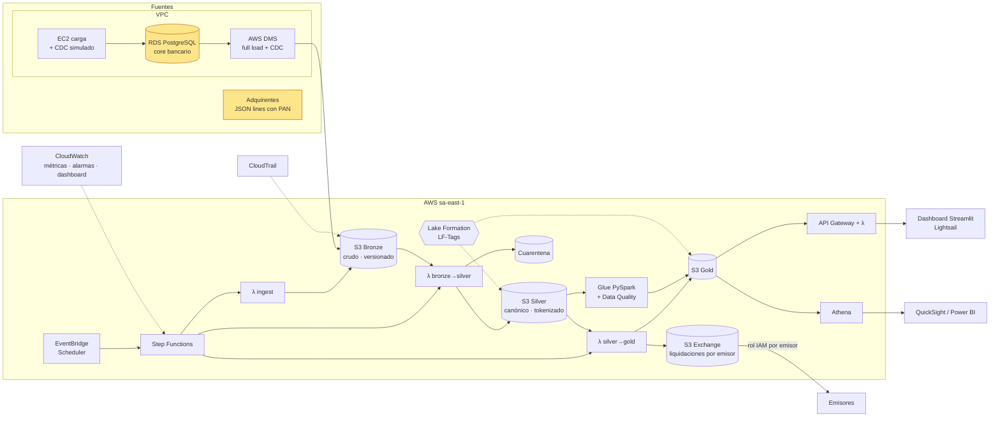

# Payments Lakehouse en AWS · Bronze / Silver / Gold

Plataforma de datos que **ingiere, depura, gobierna e intercambia** transacciones de pago con tarjeta en AWS,
siguiendo la arquitectura medallion. Todo es **infraestructura como código** (Terraform + CloudFormation),
con **IAM de mínimo privilegio** y **CI/CD en GitHub Actions vía OIDC** (sin access keys).

> ⚠️ Todos los datos son **sintéticos**: bancos, comercios, tarjetas, tipos de cambio y tasas de intercambio son inventados.

## Cobertura técnica

| Requisito | Dónde se ve en el proyecto |
|---|---|
| **S3** | 7 buckets (una capa por bucket), KMS, versionado, ciclo de vida, TLS obligatorio — [`s3.tf`](infra/platform/s3.tf) |
| **Glue** | Data Catalog (3 bases + partition projection), **job PySpark 5.0** con **Glue Data Quality** — [`glue_job.tf`](infra/platform/glue_job.tf), [`gold_card_analytics.py`](glue/jobs/gold_card_analytics.py) |
| **DMS** | Réplica **full load + CDC** de PostgreSQL (core bancario) a Bronze en Parquet — [`dms.tf`](infra/platform/dms.tf), adaptador en [`silver.py`](src/payments_lake/silver.py) |
| **Athena** | Workgroup con tope de costo, 12 consultas guardadas — [`sql/`](sql/) |
| **Lambda** | 4 funciones: ingesta, bronze→silver, silver→gold, API — [`handlers.py`](src/payments_lake/handlers.py) |
| **IAM** | Un rol por identidad, políticas acción por acción, **permissions boundary**, 25 comprobaciones automáticas — [`iam.tf`](infra/platform/iam.tf), [`docs/iam.md`](docs/iam.md) |
| **CloudWatch** | Métricas de negocio y calidad (EMF), alarmas, dashboard, Logs Insights — [`observability.tf`](infra/platform/observability.tf) |
| **CloudFormation** | Bootstrap: estado de Terraform, OIDC GitHub, rol de despliegue, boundary — [`bootstrap.yaml`](infra/bootstrap/bootstrap.yaml) |
| **CloudTrail** | Trail con eventos de datos sobre Bronze + alertas de accesos denegados y cambios de permisos — [`cloudtrail.tf`](infra/platform/cloudtrail.tf) |
| **Step Functions** | Orquestación con reintentos y backoff — [`orchestration.tf`](infra/platform/orchestration.tf) |
| **EventBridge** | Scheduler horario del pipeline + regla de fallas de Glue → SNS |
| **Lake Formation** | LF-Tags (`layer`, `sensitivity`), analista sólo Gold, analista de riesgo Silver+Gold — [`lakeformation.tf`](infra/platform/lakeformation.tf) |
| **EC2** | Instancia de carga del core (IMDSv2, sin SSH, Session Manager) — [`core_db.tf`](infra/platform/core_db.tf) |
| **VPC** | Subredes privadas/pública, endpoint S3, flow logs, security groups mínimos — [`network.tf`](infra/platform/network.tf) |
| **Medallion** | Bronze (crudo) → Silver (canónico, tokenizado, cuarentena) → Gold (productos de datos) |
| **SQL avanzado** | Ventanas, z-score, percentiles, cohortes, `ROLLUP`/`GROUPING`, `FILTER` — [`sql/advanced/`](sql/advanced/); Spark SQL en el job de Glue |
| **Python / Shell** | Paquete `payments_lake`, 30 tests; scripts PowerShell/bash en [`infra/command/`](infra/command/) |
| **Git** | GitHub Actions: tests, `terraform validate`, `cfn-lint`, ShellCheck, deploy con OIDC |
| **Observabilidad** | Dashboard CloudWatch, alarmas de calidad de datos y de seguridad, X-Ray, presupuesto |
| **QuickSight / Power BI** | Datasets en Terraform + guía — [`docs/quicksight.md`](docs/quicksight.md), [`docs/powerbi.md`](docs/powerbi.md), [`powerbi/`](powerbi/) |

## Arquitectura



### Capas

| Capa | Bucket | Contenido | Quién accede |
|---|---|---|---|
| Bronze | `paylake-dev-bronze-<cuenta>` | `transactions/` (simulador), `dms/core/<tabla>/` (réplica DMS), `core_snapshot/` (extracto JSON) | ingest, DMS y bronze→silver. **Ningún humano** |
| Silver | `paylake-dev-silver-<cuenta>` | `transactions/source_system=…/txn_date=…`, `quarantine/`, `dq_source_reconciliation/`, `dim_*` | pipeline; analista de riesgo vía Lake Formation |
| Gold | `paylake-dev-gold-<cuenta>` | KPIs, liquidación de intercambio, alertas y desempeño de reglas de fraude, corredores, segmentos de tarjetas (Glue) | API, analistas vía Lake Formation, QuickSight |
| Exchange | `paylake-dev-exchange-<cuenta>` | `outbound/issuer_id=…/settlement_date=…/settlement.csv + _manifest.json` | cada emisor, sólo su prefijo |

## Qué hace cada capa

- **Ingesta multi-fuente**: el simulador de adquirentes (con errores inyectados a propósito) y el **core bancario**, que llega
  por **DMS (CDC)** o, si DMS está apagado, como extracto JSON ([`sample_data/`](sample_data/)).
- **Silver**: esquema canónico único, tipado, deduplicación, 10+ reglas de calidad, **cuarentena** con motivo, enriquecimiento.
  El PAN se **tokeniza (HMAC-SHA256)** y nunca sale de Bronze en claro; la cuarentena lo enmascara (`510510******1234`).
  Los totales que declara el core se **reconcilian** contra Silver (6/6 métricas cuadran).
- **Gold**: KPIs por comercio, **liquidación de intercambio emisor↔adquirente**, alertas de fraude (5 reglas) y su
  **precision/recall contra fraudes confirmados**, corredores transfronterizos; segmentación de tarjetas y tendencias en Glue.
- **Intercambio de datos**: archivos de liquidación por emisor con manifiesto (SHA-256, totales), rol IAM por emisor con
  ExternalId y API REST sobre Gold.

## Estructura

```
src/payments_lake/      # paquete Python: mismo código en local y en Lambda
glue/jobs/              # job PySpark de Glue (Data Quality + Spark SQL)
scripts/core_db/        # carga y CDC simulado del core bancario (PostgreSQL)
sample_data/            # extracto core ficticio
sql/ · sql/advanced/    # consultas Athena (se publican como Named Queries)
infra/account/          # Terraform (etapa 0, desde CloudShell): grupo paylake-admins + usuario administrador
infra/bootstrap/        # CloudFormation: estado remoto, OIDC GitHub, rol de despliegue, boundary
infra/platform/         # Terraform: el lakehouse completo (iam.tf concentra todas las identidades)
infra/command/          # comandos de cada actualización: bootstrap · deploy · check_iam · destroy
dashboard/              # Streamlit + despliegue a Lightsail
docs/                   # IAM, QuickSight, Power BI
tests/                  # 30 tests
```

## 1. Ejecutar en local (sin AWS)

```powershell
python -m venv .venv; .venv\Scripts\activate
pip install -r requirements-dev.txt
pytest -q
$env:PYTHONPATH="src"; python -m payments_lake.pipeline demo --days 3
pip install -r dashboard/requirements.txt; streamlit run dashboard/app.py
```

## 2. Desplegar en AWS

> **Primera vez:** seguir [docs/antes-de-desplegar.md](docs/antes-de-desplegar.md) (cuenta, identidad de administrador con Terraform desde CloudShell, credenciales, chequeo previo y problemas conocidos).

Requisitos: AWS CLI y Terraform ≥ 1.10. La identidad de administrador también se crea con Terraform, desde
**AWS CloudShell** (que ya está autenticado): `bash infra/command/cloudshell_admin.sh` y luego `aws configure` en tu PC.
Todos los comandos viven en [`infra/command/`](infra/command/):

```powershell
./infra/command/preflight.ps1                              # antes de empezar: detecta bloqueos
./infra/command/bootstrap.ps1 -AlertEmail tu@correo.com   # una vez (CloudFormation)
./infra/command/deploy.ps1 -RunPipeline                    # cada cambio: tests → plan → apply → pipeline → check_iam
./infra/command/destroy.ps1                                # al terminar
```

Después, cada push a `main` lo despliega **GitHub Actions** con OIDC. Variables opcionales del repo:
`ENABLE_DMS`, `ENABLE_QUICKSIGHT`, `QUICKSIGHT_USER_ARN`, `ALERT_EMAIL`.

### Costos

| Pieza | Costo aproximado (sa-east-1) |
|---|---|
| Lambda, Step Functions, S3, Athena, Glue Catalog, IAM, Lake Formation | centavos |
| Job de Glue (diario, 2 DPU × ~3 min) | ~USD 0,05 por ejecución |
| KMS (1 llave) | ~USD 1 / mes |
| RDS `db.t4g.micro` + DMS `dms.t3.micro` + EC2 `t4g.nano` (`enable_dms`) | ~USD 1,5–2,5 / día |
| QuickSight (`enable_quicksight`) | prueba gratuita de 30 días |

Una semana con todo encendido ronda **USD 15–20** (estimación). `aws_budgets_budget` avisa por email al 80 % de
`monthly_budget_usd` (25 por defecto). `./infra/command/destroy.ps1 -PauseOnly` detiene la ejecución horaria.

## Decisiones de diseño

- **Lambda + pandas para el pipeline horario, Glue/Spark para la analítica diaria**: con este volumen Lambda es más barato
  y simple; el job de Glue muestra el camino de escala sobre la misma capa Silver.
- **DMS tiene prioridad sobre el extracto JSON**: ambas son la misma fuente (`source_system=core`) por distinto canal;
  Silver aplica los cambios CDC (`Op` I/U/D, gana el último `dms_ts`).
- **Idempotencia**: Silver y Gold se recalculan por ventana con `overwrite_partitions`; reprocesar da el mismo resultado (tests).
- **Lake Formation sobre Silver/Gold, IAM sobre Bronze**: los humanos nunca consultan Bronze, así que basta IAM; las capas
  consultables se gobiernan por etiquetas y heredan permisos al crear tablas nuevas.
- **CloudFormation para el bootstrap, Terraform para el resto**: Terraform no puede crear el bucket donde guarda su estado.
- **Las reglas de fraude tienen baja precisión a propósito**: `fraud_rule_performance` permite medirlas y calibrarlas con
  datos etiquetados, como se hace con un motor de fraude real.
