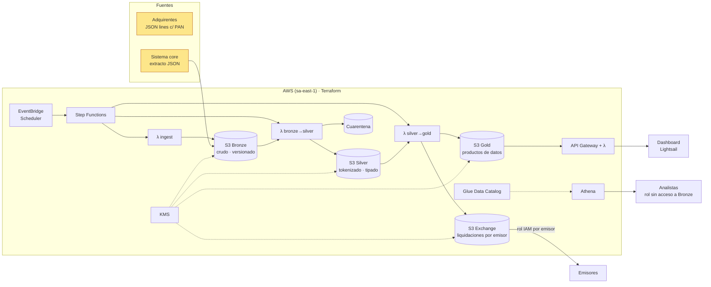

# Payments Lakehouse en AWS · Bronze / Silver / Gold

Plataforma de datos que **ingiere, depura, gobierna e intercambia** transacciones de pago con tarjeta en AWS,
siguiendo la arquitectura medallion. Todo es **infraestructura como código (Terraform)**, con **IAM de mínimo
privilegio** y **CI/CD en GitHub Actions vía OIDC** (sin access keys).

> ⚠️ Todos los datos son **sintéticos**: bancos, comercios, tarjetas, tipos de cambio y tasas de intercambio son inventados.

## Qué demuestra

| Tema | Implementación |
|---|---|
| Ingesta multi-fuente | (1) flujo horario de autorizaciones de adquirentes (JSON lines con PAN) y (2) extracto completo del sistema core (`sample_data/mastercard_db_ficticia.json`, JSON anidado en español, ya tokenizado) |
| Bronze | Datos crudos e inmutables, particionados por `ingest_date`, versionados y cifrados con KMS |
| Silver | Esquema canónico único para ambas fuentes, tipado, deduplicación, 10+ reglas de calidad, **cuarentena** con motivo de rechazo, enriquecimiento con dimensiones |
| Seguridad PCI | El PAN se **tokeniza (HMAC-SHA256)** en Silver; nunca sale de Bronze en claro (incluso la cuarentena lo enmascara: `510510******1234`). El secreto vive en SSM SecureString |
| Calidad / reconciliación | Los totales que declara la fuente core (GDV, aprobadas, fraudes, contracargos…) se reconcilian contra Silver → tabla `dq_source_reconciliation` |
| Gold | KPIs por comercio, **liquidación de intercambio emisor↔adquirente**, alertas de fraude (5 reglas), **precision/recall de cada regla vs. fraudes confirmados**, corredores transfronterizos |
| Intercambio de datos | Archivos de liquidación por emisor (`CSV + _manifest.json` con SHA-256 y totales) + **rol IAM por emisor** que sólo puede leer su carpeta (con ExternalId) + API REST sobre Gold |
| Orquestación | Step Functions (reintentos con backoff) disparado por EventBridge Scheduler; alarma CloudWatch si falla |
| Consumo | Athena (workgroup con tope de 1 GB por consulta) + consultas guardadas, API Gateway, dashboard Streamlit en Lightsail |
| Idempotencia | Reprocesar cualquier ventana produce exactamente el mismo resultado (`overwrite_partitions`) — cubierto por tests |

## Arquitectura



### Modelo de capas

| Capa | Bucket | Contenido | Quién accede |
|---|---|---|---|
| Bronze | `paylake-dev-bronze-<cuenta>` | `transactions/ingest_date=…/batch_*.jsonl`, `core_snapshot/ingest_date=…/*.json` | sólo λ ingest (escritura) y λ bronze→silver (lectura) |
| Silver | `paylake-dev-silver-<cuenta>` | `transactions/source_system=…/txn_date=…`, `quarantine/`, `dq_source_reconciliation/`, `dim_*` | λ de transformación, rol analista |
| Gold | `paylake-dev-gold-<cuenta>` | `daily_merchant_kpis`, `interchange_settlement`, `fraud_alerts`, `fraud_rule_performance`, `cross_border_corridors` | API, rol analista |
| Exchange | `paylake-dev-exchange-<cuenta>` | `outbound/issuer_id=…/settlement_date=…/settlement.csv + _manifest.json` | cada emisor, sólo su prefijo |

## Estructura

```
src/payments_lake/      # código Python (mismo código en local y en Lambda)
  generator.py          # simulador de adquirentes con errores y patrones de fraude inyectados
  bronze.py silver.py gold.py quality.py reference.py
  storage.py            # disco local o S3 + Glue (awswrangler)
  pipeline.py           # orquestación + CLI
  handlers.py           # entrypoints Lambda y API
sample_data/            # extracto core ficticio (segunda fuente)
sql/                    # consultas Athena (se publican como Named Queries)
infra/bootstrap/        # estado remoto + OIDC GitHub + rol de despliegue
infra/platform/         # el lakehouse completo
dashboard/              # Streamlit + script de despliegue a Lightsail
.github/workflows/      # CI (tests + terraform validate) y Deploy (OIDC)
tests/                  # 26 tests: calidad, silver, gold, pipeline end-to-end, API
```

## 1. Ejecutar en local (sin AWS)

```bash
python -m venv .venv && .venv/Scripts/activate      # Windows (Linux/Mac: source .venv/bin/activate)
pip install -r requirements-dev.txt
pytest -q
PYTHONPATH=src python -m payments_lake.pipeline demo --days 3
pip install -r dashboard/requirements.txt && streamlit run dashboard/app.py
```

Salida de ejemplo (`demo --days 3`):

- simulador: 18.401 registros Bronze → 98 duplicados eliminados → 515 a cuarentena → 17.788 en Silver
- extracto core: 1.500 registros → 1.500 en Silver; reconciliación **6/6 métricas OK**
- Gold: 202 archivos de liquidación para emisores; regla `ip_country_mismatch` detecta 5 de 9 fraudes confirmados (recall 56 %)

## 2. Desplegar en AWS

Requisitos: cuenta AWS, [AWS CLI](https://aws.amazon.com/cli/) configurado con un usuario/rol administrador (sólo para el bootstrap), Terraform ≥ 1.10.

```bash
# 2.1 Bootstrap (una vez): bucket de estado + OIDC GitHub + rol de despliegue
cd infra/bootstrap
terraform init
terraform apply -var="github_repo=<tu-usuario>/payments-lakehouse"

# 2.2 Plataforma
cd ../platform
cp backend.hcl.example backend.hcl        # poner el output state_bucket
terraform init -backend-config=backend.hcl
terraform apply

# 2.3 Ejecutar el pipeline una vez
aws stepfunctions start-execution --state-machine-arn "$(terraform output -raw state_machine_arn)" --input '{"generate": true}'

# 2.4 Probar la API
curl -H "x-api-key: $(terraform output -raw api_key)" "$(terraform output -raw api_url)/gold/interchange_settlement"
```

Desde ahí, los despliegues los hace **GitHub Actions**: en el repo, *Settings → Secrets and variables → Actions → Variables*,
crear `AWS_DEPLOY_ROLE_ARN` y `TF_STATE_BUCKET` (outputs del bootstrap) y un *environment* `prod`. Cada push a `main` corre
tests, `terraform plan` y `apply`; `workflow_dispatch` además ejecuta el pipeline y verifica que termine en `SUCCEEDED`.

### Dashboard en Lightsail

```bash
LIGHTSAIL_HOST=<ip> SSH_KEY=<ruta>/LightsailDefaultKey-sa-east-1.pem \
GOLD_API_URL=$(terraform -chdir=infra/platform output -raw api_url) \
GOLD_API_KEY=$(terraform -chdir=infra/platform output -raw api_key) \
./dashboard/deploy_lightsail.sh
```

### Consultas de ejemplo (Athena, workgroup `paylake-dev-analytics`)

Publicadas como *Saved queries*: reconciliación Bronze vs Silver, motivos de cuarentena, intercambio por emisor,
top comercios con alertas de fraude, corredores transfronterizos (ver `sql/`).

### Costos y apagado

Con el schedule horario el costo es de pocos USD/mes (Lambda, S3, Step Functions, Athena por consulta, 1 CMK de KMS ≈ USD 1).
Para pausar: `terraform apply -var="schedule_enabled=false"`. Para borrar todo: `terraform destroy` (en `dev` los buckets se vacían solos).

## Decisiones de diseño

- **Lambda + pandas (AWS SDK for pandas) en vez de Glue/Spark**: con este volumen (decenas de miles de filas/día) es más barato y simple. El código de transformación está aislado en funciones puras sobre DataFrames, por lo que migrarlo a Glue/EMR (PySpark) o a tablas Iceberg con `MERGE` es el paso natural al escalar.
- **Ventana de reproceso (`lookback_days`)**: Silver/Gold se recalculan sobre los últimos N días con `overwrite_partitions`; sólo se reescriben fechas completamente cubiertas por la ventana para que los datos tardíos no borren particiones antiguas.
- **El extracto core es carga completa**: siempre se procesa el último snapshot y reescribe sólo sus particiones (`source_system=core_snapshot`), sin tocar las del flujo en línea.
- **Partition projection** en Bronze: Athena consulta los JSON crudos sin crawlers.
- **Bronze conserva todo como string**: el dato se guarda tal como llegó; el tipado y las reglas viven en Silver y son auditables por la cuarentena.
- **Precision de las reglas es baja a propósito**: la tabla `fraud_rule_performance` deja medir y mejorar reglas con datos etiquetados, que es como se calibra un motor de fraude real.
