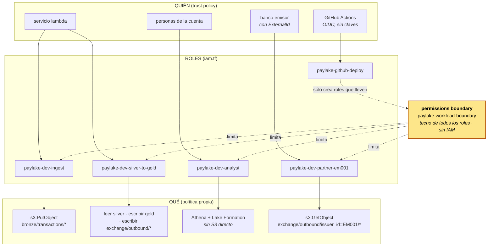

# IAM — quién accede y qué puede hacer

Todo vive en un solo archivo: [`infra/platform/iam.tf`](../infra/platform/iam.tf).
El límite máximo (boundary) y el rol de despliegue están en
[`infra/bootstrap/bootstrap.yaml`](../infra/bootstrap/bootstrap.yaml).
Las comprobaciones, en [`infra/command/check_iam.ps1`](../infra/command/check_iam.ps1).

## Etapa 0: tu identidad de administrador

Antes de todo hace falta **alguien** que despliegue. Es el problema del huevo y la gallina: para usar
Terraform o el CLI desde tu PC necesitas credenciales, y eso es justo lo que hay que crear.

La salida es **AWS CloudShell**, la terminal que trae la consola web. Ya está autenticada con tu sesión,
así que desde ahí se puede correr Terraform sin ninguna clave:

```bash
git clone https://github.com/SamahJonathan/Mastercard_AWS_deploy.git
cd Mastercard_AWS_deploy && bash infra/command/cloudshell_admin.sh
```

| Pieza | Herramienta | Por qué así |
|---|---|---|
| grupo `paylake-admins` + `AdministratorAccess` | Terraform ([`infra/account`](../infra/account/main.tf)) | el permiso vive en el **grupo**, como un binding: un rol, N miembros |
| usuario `admin-joony` y su membresía | Terraform | la persona no tiene permisos propios; sólo pertenece al grupo |
| access key | CLI (`aws iam create-access-key`) | si la creara Terraform, el secreto quedaría en texto plano en el `terraform.tfstate` |

Lo mismo que en el resto del proyecto, se usan los recursos **aditivos**: `aws_iam_group_policy_attachment`
y `aws_iam_user_group_membership`. Sus primos exclusivos, `aws_iam_policy_attachment` y
`aws_iam_group_membership`, se adueñan de **todos** los usos de esa política o de **todos** los miembros del
grupo, y borran lo que no declaren.

Después, en tu PC: `aws configure` con esa key (región `sa-east-1`). El usuario root no se vuelve a usar.
Paso a paso y problemas conocidos: [antes-de-desplegar.md](antes-de-desplegar.md).

### Dos personas, dos identidades

| Usuario | Grupo (llavero) | Para qué | Permisos |
|---|---|---|---|
| `admin-joony` | `paylake-admins` | **desplegar y apagar** (`deploy.ps1`, `destroy.ps1`, `account.ps1`) | `AdministratorAccess`. Es el equivalente a `roles/owner`: se usa sólo para operar, con MFA |
| `consultor-*` | `paylake-consultores` | **consultar tablas de Gold** en Athena, directo al entrar | las llaves del llavero (abajo) + un permiso de Lake Formation por persona |

**Las llaves del llavero `paylake-consultores`** ([`infra/account/main.tf`](../infra/account/main.tf)):

| Llave | Sobre qué | Lo que NO abre |
|---|---|---|
| consultar en Athena (`StartQueryExecution`, resultados, historial, consultas guardadas) | **sólo** el workgroup `paylake-dev-analytics` (tope de 1 GB por consulta) | otros workgroups |
| ver catálogos y metadatos de Athena | el catálogo `AwsDataCatalog` | — |
| leer el catálogo de Glue | **sólo** la base `paylake_dev_gold` y sus tablas | Silver y Bronze ni siquiera aparecen |
| `lakeformation:GetDataAccess` | credenciales temporales por tabla concedida | **sin** `s3:GetObject` sobre los datos: no puede leer los Parquet a mano |
| resultados de sus consultas | el bucket `athena-results` | los buckets de datos |
| descifrar con la llave del lake | sólo la llave con alias `alias/paylake-dev-lake` | otras llaves KMS |
| cuidar su propia cuenta | **su** usuario: contraseña y MFA | a otros usuarios; crear identidades |

**El permiso de datos (Lake Formation), uno por persona:** `SELECT` + `DESCRIBE` sobre las tablas con
`layer = gold`. Lake Formation no acepta grupos de IAM, así que Terraform lo crea para cada nombre de la lista
(`for_each`). Como es por etiqueta, las tablas nuevas de Gold quedan disponibles solas.

**Sumar a otra persona = entregarle el mismo llavero.** No se le dan llaves sueltas:

1. Agregar su nombre a `consultant_users` en [`infra/account/main.tf`](../infra/account/main.tf) (único lugar de la lista).
2. Desde la PC: `./infra/command/account.ps1`. El plan debe decir `4 to add` (usuario, membresía y sus 2 permisos de
   Lake Formation) y **`0 to destroy`**.
   Crea su contraseña temporal de consola y la guarda en `logs/credenciales-consultores.txt` (fuera de git, no se
   muestra en pantalla). Alternativa sin PC: `bash infra/command/cloudshell_consultor.sh <usuario>` en CloudShell.
3. `./infra/command/check_iam.ps1` comprueba a **todos** los miembros del grupo (6 casos por persona: consulta
   Gold, no ve Silver, no lee archivos, no asume el rol de analista, no crea identidades).
4. Commit y push del cambio en `main.tf`: el repositorio queda como registro de quién tiene acceso.

Quitar el acceso es lo inverso: borrar el nombre de la lista y aplicar (el plan muestra `to destroy` sólo de esa
persona). Las llaves siguen en el llavero para los demás.

### Dónde vive cada cosa

| | PC | GitHub | AWS |
|---|---|---|---|
| **Quién tiene acceso** (listas de personas) | se edita en `infra/account/main.tf` | se versiona: cada alta/baja es un commit | grupos `paylake-admins` / `paylake-consultores` |
| **Estado de Terraform** de las personas | — | — | `s3://paylake-tfstate-<cuenta>/account/terraform.tfstate` (mismo bucket que la plataforma) |
| **Aplicar cambios de personas** | `account.ps1` (o CloudShell) | **no**: el CI sólo valida | — |
| **Contraseñas temporales** | `logs/credenciales-consultores.txt`, fuera de git | nunca | perfil de login del usuario |
| **Comprobación** | `check_iam.ps1` | — | simulador de políticas de IAM |

GitHub Actions **no** crea personas a propósito: el rol de despliegue sólo puede crear roles de servicio con el
boundary puesto, nunca usuarios ni access keys. Las identidades humanas las administra un administrador, con su
propia credencial y MFA. Así un commit malicioso en el repositorio no puede regalarse acceso a la cuenta.

## Las dos preguntas

IAM responde siempre lo mismo: **quién** accede y **qué** puede hacer.

- El **quién** es un **rol**: una identidad para máquinas y procesos, no para personas.
  Es lo que en GCP sería una *service account*. Cada pieza del proyecto tiene la suya:
  cada Lambda, el job de Glue, DMS, la EC2, cada tipo de analista, cada banco emisor.
- El **qué** es una **política**: una lista de acciones permitidas sobre recursos concretos.

En `iam.tf` son dos mapas con la misma clave:

```hcl
identities        = { api = { name = "paylake-dev-api", trust = <lambda>, ... }, ... }   # QUIÉN
identity_policies = { api = <s3:GetObject sobre gold, ssm:GetParameter sobre la API key>, ... }  # QUÉ
```

Van separados por una razón práctica: algunas políticas nombran recursos (las Lambdas, la máquina de
Step Functions) que a su vez necesitan el rol ya creado. Juntos en el mismo mapa, Terraform veía un
ciclo: el rol espera a la Lambda y la Lambda espera al rol.

## Equivalencias con el lab de GCP

| GCP (gcp-lab-jona-01) | AWS (este proyecto) |
|---|---|
| service account `deployer-sa` | rol IAM, uno por propósito (`paylake-dev-api`, `paylake-dev-ingest`, …) |
| rol predefinido amplio (`roles/editor`) | política administrada amplia (`AWSGlueServiceRole`, `AmazonS3FullAccess`) — **no se usan** |
| rol personalizado `vm_start_stop`: el manojo con 2 llaves | política propia acción por acción (`s3:PutObject` sobre `bronze/transactions/*` y nada más) |
| binding: un rol atado a N miembros | política de confianza (*trust policy*): quién puede ponerse el rol |
| `add-iam-policy-binding` (añade) | `aws_iam_role_policy` / `aws_iam_role_policy_attachment` (añaden) |
| `set-iam-policy` (reemplaza todo) | `aws_iam_policy_attachment` (reemplaza **todos** los usos de esa política en la cuenta) — **no se usa** |
| `gcloud projects get-iam-policy … --filter` | `aws iam simulate-principal-policy` (pregunta "¿estaría permitido?") |

## Mapa conceptual



## El techo: permissions boundary

Siguiendo la imagen del manojo de llaves: el **boundary** es el tamaño máximo de la anilla. Se
puede colgar una llave de más en la política de un rol, pero si no cabe en la anilla, no abre nada.

Para que el permiso efectivo exista, tienen que decir que sí las dos:

```
permiso efectivo = política del rol  ∩  boundary
```

El boundary del proyecto permite sólo lo que usan los servicios de datos (S3 de los buckets
`paylake-*`, Glue, Athena, Lake Formation, logs, métricas…) y **niega todo IAM**: ningún rol de
carga de trabajo puede crear identidades ni tocar permisos.

### Por qué importa: la escalada de privilegios

Es el mismo problema que el `compute.instances.setServiceAccount` de la etapa 3 del lab de GCP.
El rol que despliega desde GitHub **tiene** que poder crear roles (Terraform los crea). Sin
boundary, podría crear uno con `AdministratorAccess`, asumirlo, y quedarse con la cuenta entera.
Si alguien compromete el repositorio, hereda exactamente eso.

Con el boundary, el rol de despliegue tiene tres candados:

| Candado | Dónde | Efecto |
|---|---|---|
| `iam:CreateRole` / `PutRolePolicy` / `AttachRolePolicy` sólo con `iam:PermissionsBoundary = paylake-workload-boundary` | condición en `bootstrap.yaml` | todo rol que cree nace con techo |
| `Deny iam:DeleteRolePermissionsBoundary` y `Deny` sobre la política del boundary | `bootstrap.yaml` | no puede quitar ni ensanchar el techo |
| `Deny` sobre su propio rol | `bootstrap.yaml` | no puede cambiar su confianza ni sus permisos |

## Inventario de identidades

| Identidad | Quién la usa | Llaves (resumen) | Llaves que NO tiene |
|---|---|---|---|
| `ingest` | Lambda | `s3:PutObject` en `bronze/transactions/*` | leer Bronze, escribir otras capas |
| `bronze-to-silver` | Lambda | leer Bronze, escribir Silver, catálogo Silver, secreto de tokenización | escribir Gold, leer la API key |
| `silver-to-gold` | Lambda | leer Silver, escribir Gold y `exchange/outbound/*`, catálogo Gold | **leer Bronze** (donde está el PAN) |
| `api` | Lambda | leer Gold, leer la API key | leer Silver, escribir nada |
| `pipeline-sfn` | Step Functions | invocar las 3 Lambdas del pipeline | invocar la Lambda de la API |
| `scheduler` | EventBridge Scheduler | `states:StartExecution` sobre **esa** máquina | invocar Lambdas sueltas |
| `glue-gold-analytics` | Glue | leer Silver, escribir Gold, Data Quality, sus logs | leer Bronze |
| `lakeformation-data-access` | Lake Formation | leer/escribir Silver y Gold para entregar credenciales temporales | Bronze, Exchange |
| `analyst` | personas | Athena + `lakeformation:GetDataAccess` | **S3 directo**; LF le concede sólo Gold |
| `risk-analyst` | personas | igual que `analyst` | LF le concede Silver + Gold |
| `partner-em001` … | cada banco | leer **su** carpeta `outbound/issuer_id=EM001/*` | ver la carpeta de otro banco |
| `core-loader` | EC2 | su script, el snapshot, la clave de la BD, 5 acciones de Session Manager | `AmazonSSMManagedInstanceCore` completo |
| `dms-s3-target` | DMS | escribir sólo `bronze/dms/*` | el resto de Bronze |
| `vpc-flow-logs`, `cloudtrail-logs` | servicios | escribir en **su** log group | otros log groups |
| `dms-vpc-role`, `dms-cloudwatch-logs-role` | DMS | políticas administradas de AWS | — *(DMS exige estos nombres y estas políticas: única excepción, documentada en `iam.tf`)* |

## Permisos que NO damos, y por qué

| Permiso | Lo que dejaría hacer de verdad |
|---|---|
| `s3:GetObject` sobre Bronze a cualquiera salvo `bronze-to-silver` | leer números de tarjeta en claro |
| `s3:*` | además de leer y escribir: borrar el bucket, cambiar su política, hacerlo público |
| `AWSGlueServiceRole` (administrada) | leer y escribir **cualquier** bucket cuyo nombre empiece por `aws-glue-`, entre otros |
| `AWSLambdaBasicExecutionRole` (administrada) | escribir en **todos** los log groups de la cuenta |
| `AmazonSSMManagedInstanceCore` (administrada) | mucho más que abrir una sesión: inventario, parches, asociaciones |
| `s3:GetObject` directo a los analistas | saltarse Lake Formation (y sus permisos por tabla) leyendo los Parquet a mano |
| `iam:*` a cualquier rol de carga de trabajo | crear identidades nuevas: el camino clásico de escalada |
| trust de un banco sin `ExternalId` | el *confused deputy*: que un tercero engañe al banco para usar su acceso contra nosotros |

## Añadir vs reemplazar

| Recurso de Terraform | Qué hace | Riesgo |
|---|---|---|
| `aws_iam_role_policy` | pone **la** política propia de **un** rol | ninguno |
| `aws_iam_role_policy_attachment` | ata **una** política administrada a **un** rol, respeta las demás | ninguno |
| `aws_iam_policy_attachment` | se declara dueño de **todos** los usos de una política en la cuenta | despega esa política de roles que no gestiona — el `set-iam-policy` de AWS |
| `aws_lakeformation_data_lake_settings` | reemplaza la lista **entera** de administradores de Lake Formation | quitarte a ti mismo; por eso los administradores van en una variable (`lakeformation_admin_arns`) |

## Lake Formation: el segundo piso

IAM decide **qué servicios** puede llamar cada rol. Lake Formation decide **qué tablas** puede leer
cada uno de los que llegan a Athena:

```
analista ──IAM──▶ Athena ──Lake Formation──▶ ¿tabla con tag layer=gold? ──▶ credenciales temporales para ESA tabla
```

Los permisos se conceden por **etiquetas** (LF-Tags), no tabla por tabla: la base `gold` lleva
`layer=gold` y toda tabla nueva que cree el pipeline la hereda. El analista ve las tablas nuevas sin
que nadie toque permisos.

## Comprobaciones

```powershell
./infra/command/check_iam.ps1
```

Usa el simulador de políticas de AWS (`aws iam simulate-principal-policy`): pregunta "¿esto estaría
permitido?" sin ejecutar nada. Revisa 25 casos, y **la mayoría son de lo que NO debe pasar**:

```
OK  Identidad             Accion                             Esperado      Porque
--  ---------             ------                             --------      ------
OK  ingest                s3:GetObject                       implicitDeny  escribe, pero no lee datos con PAN
OK  silver-to-gold        s3:GetObject                       implicitDeny  Gold nunca toca datos con PAN
OK  partner-em001         s3:GetObject                       implicitDeny  no ve las de otro banco
OK  paylake-github-deploy iam:CreateRole                     implicitDeny  sin boundary no puede (no fabrica un admin)
OK  paylake-github-deploy iam:UpdateAssumeRolePolicy         explicitDeny  no puede modificarse a sí mismo
...
```

- `implicitDeny`: nadie lo permitió (el caso normal del mínimo privilegio).
- `explicitDeny`: hay un `Deny` escrito que gana a cualquier `Allow`.

En el primer despliegue real, `analyst → iam:CreateUser` dio `explicitDeny` y no `implicitDeny` como esperaba la
comprobación: el `Deny` viene del **boundary**, que niega todo IAM a los roles del proyecto. La expectativa estaba
mal, no el permiso, y de paso es la prueba de que el techo está aplicado. La comprobación ahora espera `explicitDeny`.

Se ejecuta solo al final de cada `deploy.ps1`. Sale con código `0` si todo coincide.

Coste: **0**. Los roles, las políticas y el simulador no cuestan dinero.
