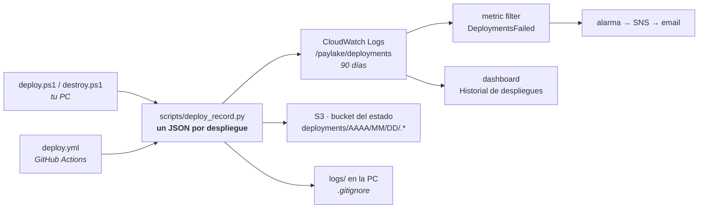

# Observabilidad de los despliegues

El proyecto ya observa los **datos** (métricas del pipeline, alarmas de calidad, dashboard). Esto
observa el **proceso de despliegue**: qué se desplegó, cuándo, quién, desde dónde y con qué resultado.

Código: [`scripts/deploy_record.py`](../scripts/deploy_record.py). Lo llaman
[`deploy.ps1`](../infra/command/deploy.ps1), [`destroy.ps1`](../infra/command/destroy.ps1) y el
workflow [`deploy.yml`](../.github/workflows/deploy.yml).

## Por qué no basta con un archivo de log

| Un `.log` en la PC | Lo que hace falta |
|---|---|
| vive en una sola máquina | un lugar central, igual para todos |
| no registra los despliegues de GitHub | mismo registro venga de donde venga |
| texto libre: hay que leerlo entero | JSON: se filtra, se cuenta, se grafica |
| crece sin límite | retención definida |

## Las capas



| Capa | Qué guarda | Dónde |
|---|---|---|
| **Registro estructurado** | un JSON por despliegue (ver abajo) | CloudWatch Logs `/paylake/deployments`, S3 `deployments/…/<id>.json`, `logs/<id>.json` |
| **Plan como evidencia** | dirección y acción de cada recurso que cambió | S3 `deployments/…/<id>.plan.json` |
| **Log completo** | todo lo que salió en pantalla | `logs/deploy-<id>.log` y S3 `<id>.log` (PC); la pestaña *Actions* (GitHub) |
| **Llamadas a la API** | cada acción contra AWS | CloudTrail (ya existía) |

### Por qué el log group lo crea el bootstrap y no Terraform

Si lo creara Terraform, `destroy.ps1` borraría el historial justo cuando más sirve. Vive en
[`bootstrap.yaml`](../infra/bootstrap/bootstrap.yaml) con `DeletionPolicy: Retain`, igual que el bucket
del estado. Terraform sólo le cuelga lo que **lee** de él: el metric filter, la alarma y el panel.

## El registro

```json
{
  "schema_version": 1,
  "deployment_id": "20261021-203000-b327197",
  "kind": "deploy",
  "result": "success",
  "failed_step": null,
  "source": "local",
  "actor": { "aws_arn": "arn:aws:iam::…:user/paylake/admin-joony", "git_user": "samahjonathan", "host": "jona-dev" },
  "run_url": null,
  "git": { "commit_short": "b327197", "branch": "main", "subject": "…", "dirty": false },
  "started_at": "2026-10-21T20:30:00+00:00",
  "duration_s": 1312.4,
  "plan": { "add": 197, "change": 0, "destroy": 0, "replace": 0, "by_type": { "aws_iam_role": 18, "…": 0 } },
  "pipeline": { "execution_arn": "arn:aws:states:…", "status": "SUCCEEDED" },
  "iam_checks": "passed"
}
```

| Campo | Valores |
|---|---|
| `kind` | `deploy`, `destroy`, `pause` |
| `result` | `success`, `failed`, `cancelled`, `no_changes`, `planned` (con `-PlanOnly`) |
| `source` | `local` (tu PC) o `github-actions` (con `run_url` al log de Actions) |
| `failed_step` | el paso exacto donde se cortó, p.ej. `5/6 Plan` |
| `error` | la causa. Si falló el pipeline, se saca del historial de Step Functions: `El pipeline terminó en FAILED en la etapa 'BronzeToSilver': TypeError: …` ([`scripts/sfn_failure_reason.py`](../scripts/sfn_failure_reason.py)) |

**Correlación**: el `deployment_id` lleva fecha y commit (`<fecha>-<sha>`); con el SHA se cruzan el
registro, el plan, el log de Actions y los eventos de CloudTrail.

## Lección del primer despliegue

Los primeros registros decían **qué** falló y **dónde** (`Smoke test`, pipeline `FAILED`, con el ARN de la
ejecución), pero no **por qué**: la causa hubo que buscarla en el historial de Step Functions. Un registro
debe bastarse solo, así que ahora incluye la etapa, el tipo de error y el mensaje.

## Qué NO se guarda: los valores

`terraform show -json` trae los valores de cada recurso **en claro, incluidos los sensibles**
(contraseñas, la API key). El registro copia sólo `address`, `type` y `actions` de cada cambio. Hay un
test que lo verifica con un secreto de prueba ([`tests/test_deploy_record.py`](../tests/test_deploy_record.py)).

## Nunca rompe un despliegue

El registro es *mejor esfuerzo*: si CloudWatch o S3 fallan, avisa y sale con `0`. En `deploy.ps1` va en
un bloque `finally`, así que se escribe aunque el despliegue falle o se cancele; en GitHub es un paso con
`if: always()`.

## Consultas útiles (CloudWatch → Logs Insights → `/paylake/deployments`)

```
# Despliegues fallidos de la última semana, con el paso que falló
fields @timestamp, source, git.commit_short, failed_step, error
| filter result = "failed"
| sort @timestamp desc

# Duración promedio por origen
stats avg(duration_s) as promedio_s, count(*) as despliegues by source

# Qué despliegue destruyó recursos
fields @timestamp, kind, source, git.commit_short, plan.destroy
| filter plan.destroy > 0
```

## Comprobación

Después de cualquier `deploy.ps1`:

```powershell
Get-ChildItem logs | Sort-Object LastWriteTime | Select-Object -Last 2      # .log y .json locales
aws logs tail /paylake/deployments --since 1h                               # el registro en CloudWatch
```

Coste: prácticamente 0 (unos KB por despliegue en CloudWatch y S3).
